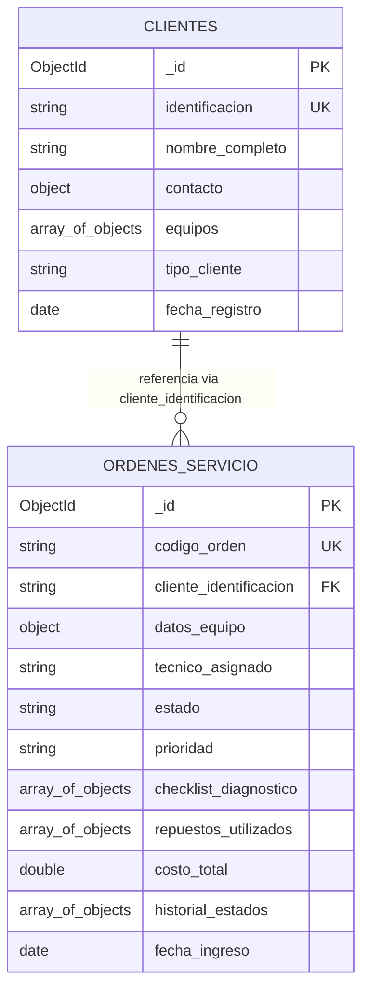

# Informe Técnico - Taller 5: Bases de Datos NoSQL con MongoDB
**Asignatura**: Bases de Datos  
**Semestre**: 4to Semestre de Ingeniería  
**Fecha**: Octubre de 2026  
**Sistema**: *TechCare Solutions* - Plataforma de Gestión de Servicios Técnicos y Mantenimiento  
**Marco Metodológico**: PDCO / SWEBOK / DAMA-BOK / Clean Code & SOLID  

---

## 1. Selección y Delimitación de la Problemática

### 1.1 Descripción y Delimitación del Problema
En las empresas dedicadas al soporte técnico, mantenimiento preventivo y reparación de equipos de cómputo y periféricos (computadores portátiles, estaciones de trabajo, dispositivos móviles y periféricos especializados), la gestión operativa enfrenta un reto recurrente: **la heterogeneidad estructural de los equipos y la trazabilidad de las intervenciones**.

Cada tipología de dispositivo posee atributos técnicos marcadamente variables (chips, zócalos de memoria, módulos de disipación, interfaces de comunicación). Durante el ciclo de vida de una orden de servicio, el equipo transita por múltiples fases (Recepción, Diagnóstico Inicial, Espera de Repuestos, Reparación, Control de Calidad y Entrega), en las cuales se registran listas de verificación (*checklists*) personalizadas según el tipo de daño y un listado dinámico de piezas o repuestos reemplazados con sus respectivos costos.

Los sistemas tradicionales relacionales rígidos suelen requerir múltiples tablas puente con campos nulos o esquemas EAV (*Entity-Attribute-Value*) que degradan el rendimiento de consulta y complican el desarrollo. *TechCare Solutions* delimita su alcance a la recepción, diagnóstico, costeo atómico de repuestos, trazabilidad cronológica de estados y entrega del equipo mediante un modelo documental optimizado.

### 1.2 Usuarios y Actores del Sistema
| Actor | Rol en el Sistema | Responsabilidades Principales |
| :--- | :--- | :--- |
| **Recepcionista / Asesor de Servicio** | Front-Office | Registro de clientes, ingreso de nuevos dispositivos y emisión de la orden de servicio con la falla inicial reportada. |
| **Ingeniero / Técnico Especialista** | Operativo | Ejecución del diagnóstico técnico, diligenciamiento del checklist de componentes, adición de repuestos/servicios y actualización de estados. |
| **Coordinador de Taller / Administrador** | Supervisión y Gestión | Monitoreo de indicadores globales, consulta de órdenes por estado y rango de costos, y depuración controlada de registros de prueba. |

### 1.3 Información que Necesita Gestionar
1. **Entidad Cliente**: Identificación única, nombre completo, datos de contacto (teléfono, correo electrónico, dirección física y ciudad) y catálogo de equipos o dispositivos asociados al cliente.
2. **Entidad Orden de Servicio**: Código único de seguimiento (`ORD-YYYY-XXX`), cliente asociado, snapshot técnico del equipo atendido, prioridad, técnico asignado, estado actual, checklist de diagnóstico técnico, desglose de repuestos y servicios prestados, historial cronológico de cambios de estado con marcas de tiempo y costo total liquidado.

### 1.4 Operaciones sobre los Datos
- **Creación (Create)**: Inserción individual o masiva de clientes y órdenes de servicio con documentos embebidos.
- **Consulta (Read)**:
  - Recuperación completa de clientes y órdenes.
  - Búsqueda por clave de negocio (`codigo_orden`, `identificacion`).
  - Filtrado condicional por estado (`RECIBIDO`, `EN_REPARACION`, `COMPLETADO`).
  - Filtrado por rango numérico con operadores BSON (`costo_total >= $100,000` vía `$gte`).
- **Actualización (Update)**:
  - Modificación del estado actual y adición concurrente del evento al historial de auditoría mediante operadores `$set` y `$push`.
  - Incorporación de nuevos repuestos al arreglo y recalculo atómico del costo total acumulado con `$push` e `$inc`.
- **Eliminación (Delete)**:
  - Supresión puntual y controlada de órdenes transitorias o de prueba mediante criterio único de búsqueda, preservando la integridad de los datos maestros.
- **Agregación Analítica (Analytics)**:
  - Agrupación por estado con cálculo de cantidad de órdenes, recaudación acumulada y costo promedio mediante el pipeline de agregación (`$group`, `$sum`, `$avg`).

### 1.5 Justificación de Pertinencia de MongoDB para el Caso
La adopción de MongoDB para *TechCare Solutions* no obedece a un mero argumento genérico de "escalabilidad o flexibilidad", sino a correspondencias directas entre las particularidades del dominio y la arquitectura del motor documental BSON:

1. **Localidad de Referencia y Transaccionalidad a Nivel de Documento**:
   - En una orden de servicio, el diagnóstico, el checklist de componentes y la lista de repuestos constituyen una **unidad atómica de consulta**. Cuando un técnico abre una orden, necesita el diagnóstico y los repuestos en una única lectura $O(1)$ por índice. En una base de datos relacional, esta operación exigiría realizar `JOIN` entre 4 o 5 tablas normalizadas (`ordenes`, `items_checklist`, `orden_repuestos`, `repuestos`, `historial_estados`). En MongoDB, el documento almacena la orden completa como un agregado consolidado, eliminando la sobrecarga de `JOINs`.
2. **Polimorfismo Estructural en Equipos y Checklists**:
   - Un computador portátil requiere evaluar bisagras, pantalla y pasta térmica; una estación de trabajo corporativa demanda evaluar fuentes redundantes y arreglos RAID; un dispositivo periférico evalúa switches o sensores ópticos. En MongoDB, el campo `especificaciones` y el arreglo `checklist_diagnostico` admiten estructuras semánticas heterogéneas sin alterar el esquema global ni exigir columnas `NULL`.
3. **Evolución Dinámica del Historial de Estados**:
   - El historial de trazabilidad de la orden crece conforme el equipo es intervenido. El operador `$push` permite anexar subdocumentos de auditoría de forma atómica sin bloquear registros ajenos.

---

## 2. Diseño del Modelo Documental (Punto 4)

### 2.1 Identificación de Colecciones
El sistema estructura los datos en dos colecciones fundamentales:
1. `clientes`: Almacena la información de los titulares y el inventario de sus equipos registrados.
2. `ordenes_servicio`: Gestiona el ciclo de vida operativo, técnico y económico de cada mantenimiento.



### 2.2 Diccionario de Datos y Tipos BSON

#### Colección: `clientes`
| Campo | Tipo BSON | Obligatorio | Descripción / Regla de Negocio |
| :--- | :--- | :---: | :--- |
| `_id` | ObjectId | Sí | Clave primaria generada por MongoDB. |
| `identificacion` | String | Sí | Identificación tributaria/personal única (ej. `CLI-1001`). Índice único. |
| `nombre_completo` | String | Sí | Nombre o razón social del cliente. |
| `tipo_cliente` | String | Sí | Dominio: `PERSONA_NATURAL`, `EMPRESA`. |
| `contacto` | Document (Embebido) | Sí | Subdocumento con `telefono` (String), `email` (String), `ciudad` (String), `direccion` (String). |
| `equipos` | Array de Subdocumentos | No | Lista de dispositivos propiedad del cliente: `numero_serie`, `tipo_equipo`, `marca`, `modelo`, `especificaciones`. |
| `fecha_registro` | String (ISO-8601) | Sí | Marca de tiempo del alta del cliente. |

#### Colección: `ordenes_servicio`
| Campo | Tipo BSON | Obligatorio | Descripción / Regla de Negocio |
| :--- | :--- | :---: | :--- |
| `_id` | ObjectId | Sí | Clave primaria generada automáticamente. |
| `codigo_orden` | String | Sí | Identificador de negocio único (ej. `ORD-2026-001`). Índice único. |
| `cliente_identificacion`| String | Sí | Referencia foránea a la `identificacion` del cliente registrado. |
| `datos_equipo` | Document (Embebido) | Sí | Snapshot inmutable del equipo intervenido (`numero_serie`, `tipo_equipo`, `modelo`, `falla_reportada`). |
| `tecnico_asignado` | String | Sí | Nombre del profesional a cargo de la orden. |
| `estado` | String | Sí | `RECIBIDO`, `EN_DIAGNOSTICO`, `EN_REPARACION`, `COMPLETADO`, `ENTREGADO`. |
| `prioridad` | String | Sí | `BAJA`, `MEDIA`, `ALTA`, `URGENTE`. |
| `checklist_diagnostico` | Array de Subdocumentos | Sí | Componentes revisados: `componente`, `estado_fisico`, `requiere_cambio`. |
| `repuestos_utilizados` | Array de Subdocumentos | Sí | Repuestos y servicios: `codigo`, `descripcion`, `cantidad`, `precio_unitario`, `subtotal`. |
| `costo_total` | Double | Sí | Sumatoria monetaria de los subtotales de la orden. |
| `historial_estados` | Array de Subdocumentos | Sí | Trazabilidad: `estado`, `fecha`, `responsable`, `nota`. |
| `fecha_ingreso` | String (ISO-8601) | Sí | Fecha y hora de recepción del equipo en taller. |

### 2.3 Justificación Técnica de Embebidos vs. Referencias
Siguiendo las directrices del modelado de datos de MongoDB y **DAMA-BOK** (Gestión de Datos Maestros):
1. **Patrón de Referencia (Normalización Parcial)**:
   - Se implementa entre `clientes` y `ordenes_servicio` mediante el campo `cliente_identificacion`.
   - *Justificación*: Un cliente es una entidad independiente de ciclo de vida prolongado que realiza múltiples órdenes en el tiempo. Si se embebieran todos los datos del cliente dentro de cada orden, cualquier cambio de teléfono o domicilio requeriría actualizaciones masivas en decenas de documentos históricos, generando redundancia e inconsistencias.
2. **Patrón de Embebido (Desnormalización Controlada)**:
   - Se implementa para:
     - `contacto` y `equipos` dentro de `clientes`.
     - `datos_equipo` (snapshot), `checklist_diagnostico`, `repuestos_utilizados` e `historial_estados` dentro de `ordenes_servicio`.
   - *Justificación*: Los repuestos y los eventos de estado **no tienen existencia ni significado fuera de la orden de servicio en particular**. Embeberlos garantiza que cualquier lectura o mutación ocurra en una única operación atómica sin concurrencia distribuida.

---

## 3. Configuración del Entorno de Trabajo (Punto 5)

### 3.1 Estructura del Proyecto
```
Taller 5 Nosql mongodb/
│
├── data/
│   └── seed_data.json          # Datos ficticios de prueba en formato JSON
├── docs/
│   └── INFORME_TALLER_MONGODB.md # Documento técnico consolidado
├── .env.example                # Plantilla de variables de entorno seguras
├── .env                        # Variables locales (ignorado en git)
├── .gitignore                  # Protección de credenciales y cache
├── crud_master.py              # Clase CrudMaster con operaciones BSON
├── database.py                 # Gestor de conexión Singleton con PyMongo
├── main.py                     # CLI interactivo y runner automatizado
├── metadata.json               # Trazabilidad PDCO y ciclo de vida
├── requirements.txt            # Dependencias oficiales
└── test_app.py                 # Suite de pruebas unitarias con unittest
```

### 3.2 Dependencias (`requirements.txt`)
```text
pymongo>=4.11.0
python-dotenv>=1.0.0
mongomock>=4.3.0
```

### 3.3 Gestión Segura de Credenciales
- Se implementó un archivo `.env.example` donde se definen las variables necesarias (`MONGO_URI`, `MONGO_DB_NAME`, `MONGO_TIMEOUT_MS`, `USE_MOCK_FALLBACK`) con valores sintéticos de ejemplo.
- El archivo `.env` que almacena credenciales reales se encuentra protegido mediante exclusión estricta en `.gitignore`, cumpliendo con las políticas de seguridad de la información (ISO/IEC 27001).
- La clase `DatabaseManager` incluye una función de enmascaramiento (`_mask_uri`) para que en ningún registro de log se impriman usuarios ni contraseñas en texto plano.

---

## 4. Desarrollo de la Aplicación en Python (Punto 6)

### 4.1 Arquitectura de Clases y Principios SOLID
- **`DatabaseManager` (`database.py`)**:
  - Aplica el principio de **Responsabilidad Única (SRP)** al encargarse exclusivamente de la configuración, apertura, verificación vía `ping` y cierre de sesiones con MongoDB.
  - Implementa el patrón **Singleton** para evitar saturar el pool de conexiones del cluster.
- **`CrudMaster` (`crud_master.py`)**:
  - Aplica **Inversión de Dependencias (DIP)** al recibir la instancia del gestor de base de datos por inyección en el constructor.
  - Ejecuta validaciones previas de integridad (comprobación de no duplicidad de códigos únicos).
  - Utiliza operadores atómicos nativos de MongoDB:
    - `$set`: Actualización de estado y datos puntuales.
    - `$push`: Adición secuencial a colecciones embebidas (`historial_estados`, `repuestos_utilizados`).
    - `$inc`: Incremento atómico del `costo_total` monetario.
  - Diseña la eliminación bajo el principio de **mínimo privilegio y criterio específico**, evitando llamadas `delete_many({})` destructivas sobre la colección principal.

---

## 5. Pruebas y Verificación del Sistema (Punto 7)

### 5.1 Plan de Pruebas Ejecutado (`test_app.py` y `main.py --auto`)
Se ejecutó la suite de pruebas unitarias sobre 6 casos de prueba con resultado exitoso ($6/6$ OK):

| ID Prueba | Caso Evaluado | Criterio de Aceptación | Resultado |
| :--- | :--- | :--- | :---: |
| `TEST-01` | Inserción de cliente con documentos embebidos | Documento persistido con arreglo `equipos` y subdocumento `contacto`. | **APROBADO** |
| `TEST-02` | Inserción de orden con checklist y repuestos | Documento persistido con costo inicial y relación a cliente. | **APROBADO** |
| `TEST-03` | Consultas filtradas (`estado` y `$gte` en costo) | Retorna exactamente los documentos que cumplen la condición matemática. | **APROBADO** |
| `TEST-04` | Actualización de estado y trazabilidad | Modifica únicamente la orden seleccionada, adiciona evento al historial y preserva otras órdenes intactas. | **APROBADO** |
| `TEST-05` | Eliminación puntual y controlada | Suprime exclusivamente la orden de prueba `ORD-TEST-999` sin afectar las órdenes operativas. | **APROBADO** |
| `TEST-06` | Resiliencia ante desconexión del servidor | Captura `ServerSelectionTimeoutError` o `ConnectionFailure` emitiendo mensaje claro sin caída inesperada del programa. | **APROBADO** |

### 5.2 Resguardo y Protección de Datos Personales
Todos los datos utilizados en el archivo `seed_data.json` y en las pruebas dinámicas fueron generados sintéticamente (nombres de fantasía, números de teléfono de prueba con prefijos estándar y números de serie ficticios), garantizando total apego a la normativa de protección de datos (Habeas Data / GDPR).

---

## 6. Comparación Exhaustiva entre SQL y NoSQL (Punto 8)

| Criterio | Bases de Datos Relacionales (SQL) | Bases de Datos Documentales (NoSQL - MongoDB) |
| :--- | :--- | :--- |
| **1. Modelo de Datos** | Tabular: Relaciones compuestas por tuplas (filas) y atributos (columnas atómicas). | Documental: Documentos jerárquicos autodescriptivos en formato BSON (Binary JSON). |
| **2. Organización de la Información** | Tablas bidimensionales estrictamente separadas. Datos descompuestos en múltiples entidades normalizadas. | Colecciones de documentos. Los datos relacionados se almacenan juntos como subdocumentos o arrays. |
| **3. Uso de Esquemas** | *Schema-on-Write*: Esquema rígido y predefinido mediante DDL. Cualquier cambio requiere `ALTER TABLE` con posible bloqueo. | *Schema-on-Read / Dinámico*: Esquema flexible. Cada documento puede contener campos distintos y evolucionar sin downtime. |
| **4. Relaciones y Embebidos** | Relaciones normalizadas modeladas mediante Claves Primarias (PK) y Foráneas (FK) forzadas por el motor. | Soporta documentos embebidos para relaciones de agregación y referencias lógicas (ObjectId/Strings) para datos maestros. |
| **5. Consultas y Actualizaciones** | Lenguaje declarativo SQL (`SELECT`, `JOIN`, `UPDATE`). Modificar estructuras jerárquicas exige múltiples `UPDATE` coordinados. | MQL (MongoDB Query Language) con operadores de array y objeto (`$set`, `$push`, `$pull`, `$inc`) y Aggregation Pipelines. |
| **6. Integridad y Consistencia** | Modelo **ACID** estricto por defecto a nivel de múltiples tablas. Integridad referencial reforzada por el motor. | Consistencia inmediata y atomicidad a nivel de documento individual. Transacciones multi-documento disponibles desde v4.0. |
| **7. Flexibilidad del Modelo** | Baja. Reestructurar tipos de datos o agregar atributos técnicos variables requiere migraciones complejas. | Alta. Ideal para estructuras polimórficas (como equipos con diferentes configuraciones de hardware). |
| **8. Escalabilidad** | Predominantemente **Vertical** (*Scale-Up*: más CPU, RAM y almacenamiento en un único nodo). | Nativa **Horizontal** (*Scale-Out*: particionamiento automático de datos o *Sharding* distribuido en clusters). |
| **9. Ventajas y Limitaciones** | **Ventajas**: Madurez, integridad relacional estricta, consultas analíticas complejas universales.<br>**Limitaciones**: Rigidez, costo alto de escalabilidad, sobrecarga de `JOINs` en modelos anidados. | **Ventajas**: Altísimo rendimiento de lectura/escritura, coincidencia natural con objetos de programación (JSON), esquema ágil.<br>**Limitaciones**: No optimizado para grafos densos de relaciones inter-tablas continuas sin desnormalizar. |
| **10. Casos de Uso Apropiados** | Sistemas bancarios, contabilidad de doble partida, ERPs tradicionales donde la estructura de datos es universalmente estática. | Catálogos de productos con atributos variables, gestión de órdenes y soporte técnico, IoT, registros de auditoría y Big Data. |

### 6.1 Conclusión Técnica Justificada
Para el sistema **TechCare Solutions**, la adopción de **MongoDB resulta técnicamente superior frente a un modelo relacional tradicional**, fundamentado en tres razones de arquitectura de software:

1. **Alineación con el Dominio del Negocio**: La orden de servicio es conceptualmente un documento compuesto. Representarla en SQL exigiría fragmentar una orden en cinco tablas distintas (`Orden`, `Checklist`, `Repuesto`, `Historial`, `Equipo`), encareciendo cada consulta con costosas operaciones de ensamble (`JOIN`). En MongoDB, la orden se recupera, actualiza y serializa como una entidad coherente y completa.
2. **Capacidad de Representar Hardware Polimórfico**: Los dispositivos atendidos varían desde portátiles convencionales hasta servidores multiprocesador. MongoDB permite que el subdocumento `datos_equipo` y el arreglo `checklist_diagnostico` se adapten dinámicamente a cada tecnología sin requerir complejas jerarquías de herencia relacional (como *Table-per-Hierarchy* o *Table-per-Type*) ni columnas huérfanas con valores `NULL`.
3. **Equilibrio Óptimo de Rendimiento**: Al desnormalizar los repuestos e historial dentro de la orden y mantener al cliente referenciado por identificador único, se optimizan los tiempos de respuesta de lectura y escritura a la vez que se previene la duplicidad de datos maestros.

No se afirma que MongoDB sea una solución universal para cualquier proyecto informático, pero para aplicaciones de gestión documental operativa, trazabilidad técnica y catálogos de hardware, sus propiedades arquitectónicas ofrecen la mayor eficiencia y mantenibilidad para el ciclo de vida del software.
